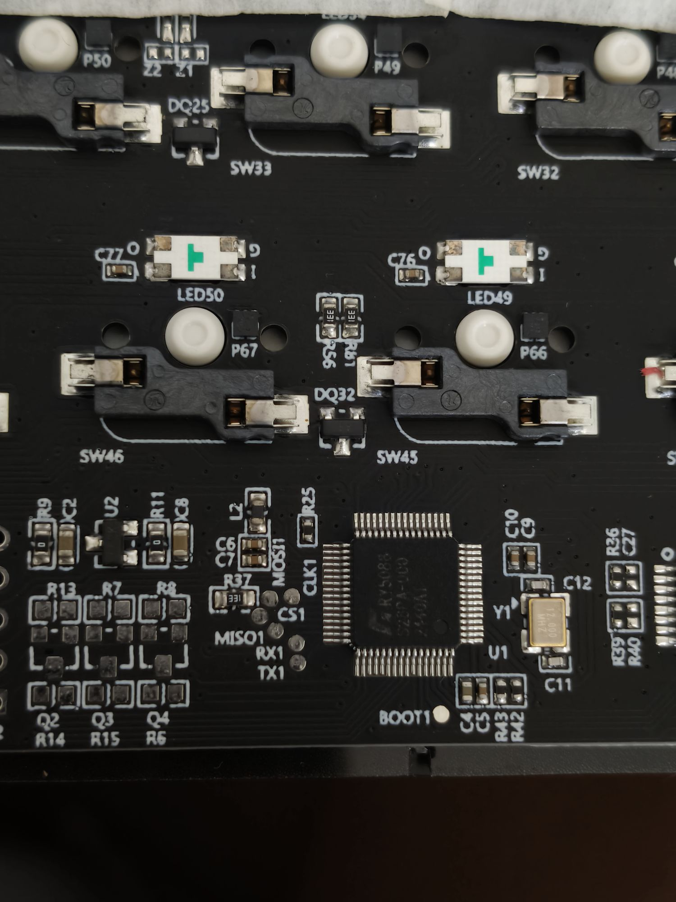
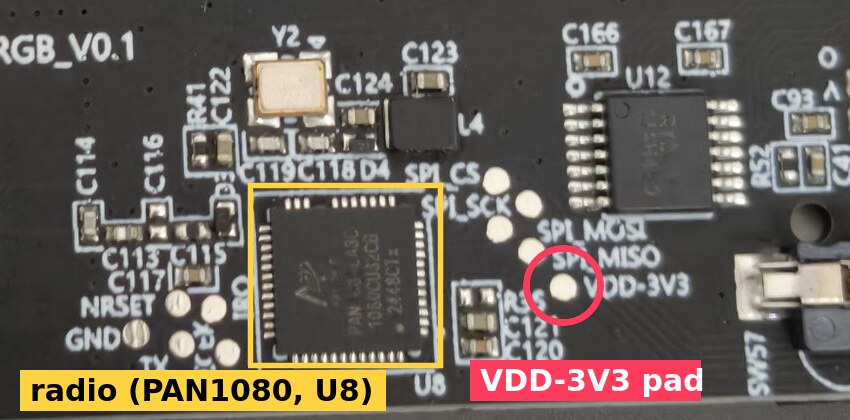

<!-- banner:start -->
> [!CAUTION]
> **This entire project was done with LLMs:** Claude Opus 5.5 (medium and xHigh reasoning) for the
> reverse engineering, the firmware, the driver, the tools and these docs, and Gemini 3.8 / 3.7
> Flash (High) at the start, which is the one that bricked the keyboard. I did not check every
> byte of it, and I am **not responsible for anything in here that turns out to be wrong.** Some
> of it probably is. Flash something because a README told you to, turn your keyboard into a
> very expensive paperweight, and that is on you. Not me, not Claude, you.
>
> Read the code yourself. Check every pin and every command before you run it. Better yet, do
> the shi yourself and use this as a map, not a manual. **You have been warned.**

**Same thing, but shorter and just looks nicer i guess? → [vivlos.dev/fun60](https://vivlos.dev/fun60/)**
<!-- banner:end -->


# re-fun60-ultra-tmr: open firmware for the MonsGeek FUN60 Ultra TMR

Open firmware and a web driver for the MonsGeek FUN60 Ultra TMR (board ID 2307), written from
scratch after taking the stock firmware apart.

Two things started this:

- **Double typing with mechanical switches.** Put mechanical switches in this board and hard
  taps type the letter twice. Light taps are fine. The debounce slider in MonsGeek's app changes
  nothing, and there is no fixed firmware: v306 (2025-03-14) is still the latest for this board.
- **The MonsGeek web driver.** It's a pain to use and barely works on Linux.

It turned into a full replacement firmware. It's still a work in progress, so read the
[status list](#2-status) before you flash anything.

Written 2026-09-30, updated 2026-10-26 for firmware v0.12. Stock firmware analysed: v306 for board 2307.

> **This firmware was made for mechanical switches.** v0.12 adds basic magnetic switch support
> (per-key actuation, learned the way stock does it) but nobody has typed on it with magnetic
> switches yet. Tested on exactly one keyboard.

## -2. Changelog

Newest first. Small wording fixes are not listed.

**2026-10-26**

* Firmware v0.12: basic magnetic switch support, not tested on the keyboard yet. Each key learns
  where it rests and how deep it goes, like stock does, and presses at a percent of that travel
  (50 % by default, released under 35 %). Mechanical and magnetic switches can be mixed. The web
  driver's thresholds are percents now (protocol v5). Saved settings reset to defaults once.

**2026-10-25**

* Docs reorganised into this one README (the old `docs/story.md`, `docs/hw-map.md` and
  `docs/recovery.md` are sections 3 to 8 and 12 now). Short version on vivlos.dev.
* Added 0.5: flashing from a virtual machine, from the first issue report.

**2026-09-30**

* First version: firmware v0.11, FUN60 Studio, ry-flash changes.

## -1. What?

Stop mechanical switches double typing on the FUN60 Ultra TMR, and get rid of MonsGeek's web
driver. Both meant replacing the firmware, so that's what this is.

## 0. How to flash

Linux, as written. Flashing goes through the keyboard's own bootloader over USB, so there's no
need to open the case. Everything below uses nix-shell; any Linux with the same tools works too.

**0.1 Build.**

```sh
# firmware -> fw/build/fun60_dfu.bin (fetches Artery's BSP into fw/vendor the first time)
nix-shell -p gcc-arm-embedded gnumake git --run 'make -C fw vendor && make -C fw'
nix-shell -p gcc --run 'make -C fw test'          # host tests

# flasher
cd flasher && nix-shell -p cargo rustc pkg-config udev openssl --run 'cargo build --release' && cd ..
```

A flasher built inside nix-shell only runs where Nix is installed. On another distro, build it
with that distro's packages (on Ubuntu: `cargo pkg-config libudev-dev libssl-dev`).

**0.2 Flash.** The keyboard can be on stock or on this firmware.

```sh
sudo flasher/target/release/ry-flash --image fw/build/fun60_dfu.bin --custom --arm
```

**0.3 Back to stock.** This downloads v306 from MonsGeek's server and flashes it:

```sh
sudo flasher/target/release/ry-flash --auto --stock-dir stock --arm
```

**0.4 If it goes wrong.**

- Hold **Esc** while plugging the cable in: the keyboard goes straight to its bootloader
  (`lsusb` shows `3151:502a`), then flash again. This needs a working mechanical switch on Esc.
- A build that hangs, or never talks to the PC in its first 10 s, drops itself into the
  bootloader. The watchdog handles hangs; a "has a host ever answered" check handles the rest.
- A keyboard stuck as `3151:502a` is not bricked. That's the bootloader, and any successful flash
  brings it back. Run the same flash command again.
- If all of that fails, you open the case and bridge one pad: [section 5](#5-recovery-with-the-case-open).
  I've had to do it once.

**0.5 Virtual machines.** Flash from Linux on real hardware if you can. When the keyboard switches
to its bootloader, it disconnects and comes back as a different USB device (`3151:502a`), and at
full speed instead of high speed. A VM's USB passthrough usually doesn't follow it, so ry-flash
gives up with "did not re-enumerate to bootloader (502A) within 20s", and the keyboard sits in the
bootloader on the host. In the one report so far (VirtualBox with its USB 2.0 controller),
connecting it to the VM by hand put it on the emulated USB 1.1 controller, where the flash
commands timed out (`hidapi error: ioctl (SFEATURE): Timer expired`). A Linux live USB on the
same PC works. In VirtualBox, switching the VM to the USB 3.0 (xHCI) controller and adding USB
filters for both `3151:5030` and `3151:502a` might work, but nobody has tested it.

## Contents

1. [The board](#1-the-board)
2. [Status](#2-status)
3. [The double typing](#3-the-double-typing)
4. [The brick](#4-the-brick)
5. [Recovery with the case open](#5-recovery-with-the-case-open)
6. [The old firmware tree](#6-the-old-firmware-tree)
7. [Writing new firmware](#7-writing-new-firmware)
8. [Battery, radio, lights](#8-battery-radio-lights)
9. [Keys](#9-keys)
10. [Web driver](#10-web-driver)
11. [Tools](#11-tools)
12. [Hardware map](#12-hardware-map)
13. [Corrections and open questions](#13-corrections-and-open-questions)
14. [Credits](#14-credits)
15. [License](#15-license)


## 1. The board

| Item | Value |
| :--- | :--- |
| Keyboard | MonsGeek FUN60 Ultra TMR, 60%, 61 keys, per-key RGB |
| Board ID | 2307 (`dev_id` in MonsGeek's firmware server) |
| Stock firmware | v306 (2025-03-14), still the latest |
| MCU | Artery AT32F405RCT7, silkscreened "RY5088" |
| USB | `3151:5030` running (high speed), `3151:502a` in the bootloader (full speed) |
| Radio | PAN1080 for 2.4G and Bluetooth, with its own firmware and pairings |
| Switches | magnetic (TMR) from the factory; the sockets take mechanical ones too |

The switch under the Caps Lock keycap has three positions. Top is wireless (Mac), bottom is
wireless (Windows), and the middle disconnects the battery. Every pin and timing is in
[section 12](#12-hardware-map).

## 2. Status

Working, tested on my board:

- USB typing with the stock layout, plus the Fn layer (F keys, media, arrows)
- **no more double typing**: 0 doubles in 121 hard taps, where stock did 13 to 165 per run
  ([numbers below](#3-the-double-typing))
- per-key RGB: static, breathe, rainbow, brightness, on/off
- **2.4G wireless** through the stock dongle (Fn + Y). A dongle paired under stock just works.
- stock's indicator lights: the mode key blinks or stays lit, battery level on Esc
  (Fn + Space), charging, low battery, Caps Lock, Win lock (Fn + Win)
- battery level and charging state
- settings saved on the keyboard: keymap, lighting, debounce, actuation
- FUN60 Studio, a web driver: remap, lighting, performance, save and restore, a double-press tester
- recovery without opening the case (hold Esc while plugging in), plus a watchdog failsafe

Built, not tested yet:

- magnetic switches (v0.12): each key learns its rest and bottom like stock (bottom starts
  400 counts under rest), presses at a percent of that travel. Holding Esc while plugging in
  still uses mechanical thresholds, so with a magnetic Esc it may not reach the bootloader; the
  watchdog failsafe still does.
- Bluetooth 1 to 3 (Fn + E, R, T; hold 3 s to pair, it shows up as "FUN60 Ultra-1/2/3")

Not done:

- **sleep.** On battery the chip runs flat out, and only the LEDs turn off after 5 minutes idle.
  Don't leave it on battery for days.
- the web driver over 2.4G (USB cable only for now)
- Mac mode: the switch's top position is read but ignored
- NKRO: 6 keys at once, like a boot keyboard
- magnetic switch extras: rapid trigger, a different actuation per key, calibration that
  survives a power cycle, stock's travel-to-millimetre curve (actuation is a percent, not mm)
- the MonsGeek app will not work with this firmware, and that's not planned

## 3. The double typing

### 3.1 The problem

The FUN60 Ultra TMR ships with magnetic (TMR) switches, but the sockets take mechanical ones too.
With mechanical switches, hard taps sometimes type the letter twice. Light taps never do. The
debounce setting in MonsGeek's web driver doesn't help (plenty of people complain about it), and
MonsGeek's own advice is to pick the switch type and recalibrate. Their firmware server still lists
v306 from 2025-03-14 as the latest for this board.

### 3.2 Measuring it

Before fixing anything I wanted numbers, so [`scripts/chatter_test.py`](scripts/chatter_test.py) logs every press and release
from the keyboard with timestamps and flags re-presses under 30 ms. The runs below are me
hammering one key as hard as I could. A "double" is the same key reported again less than 30 ms
after its release. The logs are in [`data/chatter/`](data/chatter/), and you can re-check them with
`python3 scripts/chatter_test.py --analyze data/chatter/<file>`.

| Log | Firmware | Presses | Doubles |
|---|---|---|---|
| `chatter-20260928-181930.csv` (D) | stock v306 | 122 | 13 |
| `chatter-20260928-182151.csv` (H) | stock v306 | 157 | 34 |
| `chatter-20260928-182547.csv` (G) | stock v306 | 235 | 113 |
| `chatter-20260928-183235.csv` (G) | stock v306 | 302 | 165 |
| `chatter-20260928-203353.csv` (G) | this firmware | 121 | 0 |

Claude's first reading was that the switch was bad. I didn't buy it: I swapped switches, and on
every one light taps were clean and hard taps doubled. So the logs got a closer look.

### 3.3 What's going on, and the fix

On a hard tap, the contact opens for 0.1 to 6 ms in the middle of the press, and flickers when it
first closes. Stock reports every one of those as a new key press. That's a firmware problem.

This firmware reports the press the moment the contact closes, but only reports the release once
the contact has stayed open for 8 ms. QMK calls this `asym_eager_defer_pk`. You get no added
delay on presses, and bounces can't turn into extra presses. The 8 ms can be changed in the
driver (0 turns it off).

The tester's first "how long a lockout would you need" formula was wrong for bursts of bounces.
It was replaced by replaying each log through real filters and counting what gets through.


## 4. The brick

The short version: mechanical switches double typed on this board, an AI flashed a firmware that
bricked it, I opened it up and recovered it, and then the stock firmware got taken apart and
replaced. Here's the long version, mistakes included.

I started on 2026-09-27 from [dot-agi/ry5088-flasher](https://github.com/dot-agi/ry5088-flasher),
which has two parts: `ry-flash`, a USB flasher that talks to the keyboard's factory bootloader,
and a `firmware/` tree meant to be custom firmware for these boards. I had Gemini CLI add an
"eager debounce" to that firmware, build it and flash it.

The flash itself went fine: every chunk was transferred and the checksum matched. Then the keyboard
rebooted into the new firmware and never came back. No lights, and nothing on USB.

The cause was the build: `firmware/Makefile` compiled for `USB_OTG_FS`, the AT32F405's full-speed
USB controller on PA11/PA12. This board's USB-C port is wired to the other one, the high-speed
controller with its own PHY. So the firmware ran and brought up a USB port with nothing attached.
That setting was already in the upstream Makefile; nobody had run that tree on this board, and
Gemini flashed it without checking.

Why that's a brick: the factory bootloader at 0x08000000 only stays in flashing mode if a magic
word (0x55AA55AA at 0x08004800) is set, and the only thing that sets it is the running firmware,
when a flasher asks it over USB. A firmware without working USB can never be asked.

## 5. Recovery with the case open

Try the easy ways in [0.4](#0-how-to-flash) first. This is for when they don't work, for example
after a firmware that breaks USB, like the one that started all this. It's what got the board
back on 2026-09-28.

The AT32F405 has a ROM bootloader that nothing can overwrite. It runs instead of the flash when
the BOOT0 pin is high at power-up, and it speaks USB DFU. You can write the full stock image back
with it, factory bootloader included.

### 5.1 What you need

- a way to get the PCB out of the case (the pads are on the bottom side, with the switch sockets)
- a short wire or tweezers
- `dfu-util` (`nix-shell -p dfu-util`)
- the stock image. ry-flash downloads it from MonsGeek's server:
  `flasher/target/release/ry-flash --fetch 2307 --stock-dir stock` gives
  `stock/2307/fw_at32.bin` (110268 bytes, bootloader plus v306)

### 5.2 Steps

1. Unplug the cable and disconnect the battery connector.
2. Find the round pad silkscreened **BOOT1** just below the MCU (the chip marked RY5088). Despite
   the label, it's the chip's BOOT0 pin (pin 60).

   

3. Find the **VDD-3V3** pad next to the radio chip (PAN1080, U8), at the end of the SPI pads.

   

4. Bridge BOOT1 to VDD-3V3 and, while holding it, plug the cable in. Let go after a second.
5. Check that the ROM bootloader is there:
   ```
   lsusb | grep 2e3c:df11        # "Artery-Tech DFU in FS Mode"
   ```
6. Write the stock image:
   ```
   nix-shell -p dfu-util --run 'sudo "$(command -v dfu-util)" -a 0 -d 2e3c:df11 -s 0x08000000:leave -D stock/2307/fw_at32.bin'
   ```
   `:leave` restarts the chip when it's done, and the keyboard comes back on stock v306.
7. From there, ry-flash works over USB again, with no need to open the case. Put the battery back.

If `2e3c:df11` doesn't show up, the bridge wasn't making contact when the cable went in. Unplug
and try again.

## 6. The old firmware tree

With the board alive, Claude went through the `firmware/` tree (upstream plus Gemini's edits) to
see what else was wrong. Besides the USB port:

- it never switched on the sensor power rails, so every key read 0 (stock turns on PC14, then PC5
  20 ms later, then PA7 100 ms after that)
- the ADC was never given a trigger, so the first key read would hang forever
- one HID interface had no interrupt endpoint, which Linux's usbhid refuses
- the linker gave it 102 KB of RAM on a 96 KB chip
- the USB device version bytes were swapped
- it never set the bootloader mailbox, so ry-flash couldn't get back in either
- the pin map didn't match this board at all

That was enough to stop trusting any of it. The plan became: decompile the stock firmware, write
down what it actually does with every pin, and write new firmware on Artery's own BSP.

ry-flash itself worked, but it would flash any image with `--arm`. It now only arms the published
stock image for the connected board unless you add `--custom`, a hash mismatch on a downloaded
image is an error instead of a warning, and it says what to check when a board doesn't come back.

## 7. Writing new firmware

The stock firmware (v306) was decompiled with Ghidra and read function by function. Every pin,
timing and protocol detail the firmware relies on is in [section 12](#12-hardware-map), next to
the stock function it came from, so all of it can be checked. The code in [`fw/`](fw/) is new and sits
on Artery's own BSP. Nothing from MonsGeek is included.

Things that went wrong on the way to the first working build:

- **The USB "proof".** Before writing anything, Claude claimed a scan of the stock binary proved
  it uses the high-speed USB port. The scan didn't prove that (it looked for a value that is never
  stored as data). The real evidence was already in the kernel log: stock enumerates at high speed.
  The Makefile now refuses to produce an image without the high-speed interrupt handler in it.
- **A stale build.** v0.02 went out with old object files because the Makefile didn't track header
  changes, so it reported the wrong key count and version. Fixed with `-MMD -MP`.
- **Skipped columns.** The column shift register was clocked too fast. Whole columns glitched once
  a frame, and one clock was always lost at column 10. Waiting about 300 ns between edges fixed it.

The first working build typed the full layout and did 0 doubles in 121 hard taps. After that came
the LEDs (61 WS2812s fed by SPI2 and DMA), media keys, arrows, settings in flash, the failsafe, and
FUN60 Studio. At one point the driver said it couldn't save: that was v0.04 not having the save
command yet, and v0.05 fixed it.

## 8. Battery, radio, lights

All of this landed on 2026-09-30.

- **Battery.** It's read through the same ADC as the keys, on mux channel 7. That channel had read
  about 69 all along because the battery was unplugged.
- **Radio.** The 2.4G and Bluetooth side is a separate PAN1080 chip with its own firmware and its
  own pairings. The main chip only tells it which mode to be in and hands it HID reports, over SPI3
  with a small framed protocol (`[cmd][length][payload][sum]`). That was decoded from stock and
  rebuilt. The first status reply checked out on the first try.
- **Indicators.** Stock's colours live in its RAM init data, which the compiler stores compressed.
  They came out by transcribing stock's own decompressor. The same code also gave away the LED
  chain order: a snake, left to right on the top row, right to left on the next, and so on.

Two more mistakes:

- **The switch.** MonsGeek's guide says the switch under Caps Lock has wired in the middle, and
  stock picks wired mode from PC13. So for one version PC13 was treated as the switch. Measuring
  all three positions showed PC13 is simply USB power; the switch only changes PB1 (top = Mac), and
  its middle position disconnects the battery.
- **The Fn key.** None of the Fn combos worked, and it looked like a firmware bug for a while. A
  live view of what the keyboard thinks is held (`rawscan.py --keys`) showed Fn never closing, even
  though it had worked on 09-28. The switch was broken. A new switch fixed it.

After that: typing over 2.4G through the stock dongle, which had been paired under stock and
reconnected without pairing again.

## 9. Keys

The layout is stock's. Fn layer:

| Fn + | Does |
|---|---|
| Esc, 1 to =, Backspace | `, F1 to F12, Delete |
| I, P | Insert, Print Screen |
| E, R, T / Y / U | Bluetooth 1, 2, 3 / 2.4G / USB (hold E R T Y 3 s to pair) |
| Enter, [, ], \ | lights on/off, dimmer, brighter, next effect |
| C, M, comma, period | Calculator, Mute, Volume down, Volume up |
| /, Right Alt, Menu, Right Ctrl | Up, Left, Down, Right |
| Win | Win lock |
| Space | battery level on Esc: red < 35 %, blue < 55, magenta < 75, yellow < 95, green |

With the cable in, the keyboard starts in USB mode. Unplug it (with the Caps Lock switch at the
top or bottom) and it carries on in the last wireless mode.

## 10. Web driver

FUN60 Studio, in [`driver/`](driver/):

```sh
nix-shell -p python3 --run driver/serve.sh     # then open http://127.0.0.1:8060
```

It needs a Chromium-based browser (Chrome, Chromium, Brave) for WebHID, plus access to the
keyboard's hidraw node. A udev rule does that:

```
KERNEL=="hidraw*", SUBSYSTEM=="hidraw", ATTRS{idVendor}=="3151", TAG+="uaccess"
```

On NixOS it goes in `services.udev.extraRules`; elsewhere it's a file in `/etc/udev/rules.d/`.
Without a keyboard, the driver runs a demo.

## 11. Tools

- [`scripts/chatter_test.py`](scripts/chatter_test.py): double-press tester. It reads the keyboard through evdev and logs
  every press and release to CSV. `--analyze` replays a log through different debounce filters.
- [`scripts/rawscan.py`](scripts/rawscan.py): talks to this firmware's vendor interface. With no options it shows the
  raw sensor grid live. `--keys` shows the keymap in RAM and what's held, `--power` battery and
  charging, `--radio` the wireless link, `--mode 24g` switches mode from the PC.
- [`scripts/analyze_session.py`](scripts/analyze_session.py): makes sense of a `rawscan.py --record` capture.
- [`scripts/build_readme.py`](scripts/build_readme.py), [`scripts/build_site_page.py`](scripts/build_site_page.py): build this README from [`docs/src/`](docs/src/), and
  the vivlos.dev page from it and [`docs/short.md`](docs/short.md).


## 12. Hardware map

Derived from stock firmware v306 (`stock/2307/fw_at32.bin`, SHA-256 matches the vendor manifest)
by decompiling it with Ghidra 12 and reading the result. Every row names the stock function it
comes from, so any of it can be re-checked. Nothing here comes from the older `firmware/` tree
or its docs. Confirmed on the board itself where marked.

### 12.1 MCU and clocks

| Item | Value | Evidence |
|---|---|---|
| MCU | AT32F405RCT7 (LQFP64), silkscreen "RY5088" | board photo |
| Crystal | 12.000 MHz (Y1) | board photo; `crm_pll_config(HEXT, 72, 1, FP_4)` in `system_clock_config` @0x08016650 |
| SYSCLK / PLLU | 216 MHz / 48 MHz (`crm_pllu_div_set(5)`) | @0x08016650 |
| USB | OTGHS1 on-chip PHY, high speed | stock enumerates high-speed (kernel log 2026-09-27) |
| App | vector table 0x08005200, VTOR set by `main` @0x08014b90 (`nvic_vector_table_set(0x08000000, 0x5200)`) | main |
| Delays | SysTick: `FUN_08013b40(n)` = n us, `FUN_08013ae4(n)` = n ms | decompile |

### 12.2 Board init (`FUN_080167b8`, called from main)

All pins are first set to analog by `FUN_08013078`. Then:

| Pin | Config | Initial | Role (evidence) |
|---|---|---|---|
| PB1 | input, pull-up | read into config bits 1-2 | **mode switch at the top (Mac) when low**: measured 2026-09-30, low at the top, high in the middle and at the bottom. `FUN_08014e70` polls it and after 15 steady reads flips the same bits a key action flips (`FUN_0800cfb0` case 10), saves config and reloads the keymaps from `bits * 0x400` (a Mac layout) |
| PC13 | input, pull-up | | **USB power present when high**: measured high in all three switch positions with the cable in. Stock boots in wired mode on it (`FUN_08014ef4`), only allows Fn + U with it high (key handler case 0xe / 6), and runs the battery rules above on it. The switch under Caps Lock (top = wireless Mac, middle = wired with the battery disconnected, bottom = wireless Windows, per MonsGeek's FUN60 guide) is not read for the mode: its middle position just cuts the battery (the battery reading rises slightly there, 1509 vs 1488 counts, as the load goes away) |
| PA3 | input, pull-up | | charger IC status, low = charging: with PC13 high, low caps the level at 99 % and lights LED 0 red (`FUN_080148dc`) |
| PB13 | output | high | LED power: pulled low after the last LED DMA frame before sleep (`FUN_080154b4`), set high again before the LEDs are re-initialised (`FUN_08014f38`) |
| PC4 | output | high | ? : in the sleep loop, high while the battery is under 41 %, low above (`FUN_080154b4`) |
| PC8 | output | high | column shift-register data |
| PC9 | output | high | column shift-register clock |
| PA8 | output | high | column output enable, active low |
| PB7, PB8, PB9 | output | | row mux address A2, A1, A0 |
| PC14 | output | high first | power enable 1 (off during timed deep sleep) |
| PC5 | output | high 20 ms after PC14 | power enable 2 (stays on in sleep) |
| PA7 | output | high 100 ms after PC5 | power enable 3 (off during timed deep sleep) |

The PC14, PC5, PA7 sequence with delays looks like rail sequencing through the three
transistors next to the regulator (Q2 to Q4 on the PCB). Without it every sensor reads 0 V
(confirmed on the board: all 84 sites read 0 to 2 counts under the old firmware, which drove
none of these).

### 12.3 Key scan (`keyscan_column` @0x0800577c, one column per call from the main loop)

ADC (`FUN_08012d60`): ADC1 channel 2 on **PA2** (analog), clock HCLK/8 = 27 MHz, sample time
28.5 cycles, single conversion, **software trigger enabled** (`OCTESEL = 111`, `OCTEN = 1`),
calibrated, then 1000 warm-up conversions. **PF7** is an output left low: the mux enable
(74HC4051-style INH, active low).

Per column `c` (0..13):
1. PC8 high, PA8 high, mux address 000.
2. `c + 1` times: PC9 high, PC8 low, PC9 low. (Walks a single 1 to output `c`.)
3. PA8 low (outputs on), wait 5 us.
4. For row `r` = 1..5 (row 0 is never scanned; sites flagged in a table at RAM +0x1822 are
   skipped): select mux channel `r - 1`, except column 6 row 5 which uses channel 6
   (`row_mux_select` @0x0801207c: A0 = PB9, A1 = PB8, A2 = PB7). Wait 1 us, convert.
   Stock keeps an 8-sample ring per site and averages it.
5. `c + 1`; after 13 wrap to 0. Then PA8 high, mux 000, and `14 - (c + 1)` more clock pulses
   (14 on wrap) to shift the 1 out of the chain.

So the matrix is **14 columns x 5 rows = 70 sites**, not 84.

### 12.4 Other peripherals stock enables

GPIOA-D, GPIOF, PWC, DMA1, ADC1, SPI2, SPI3, TMR4, TMR6, OTGHS. SPI3 on PB3/PB4/PB5 (plus
PA15, PD2) goes to the PAN1080 radio (`FUN_08016344`); SPI2 + DMA1 drive the LEDs (below); TMR6
is stock's tick (its interrupt also restarts LED frames).

### 12.5 LEDs (per-key RGB, WS2812-class)

| Item | Value | Evidence |
|---|---|---|
| Count | 61, one per key (1464-byte frame = 61 x 24) | `FUN_080158d0` fills two 0x5B8 buffers |
| Data pin | PA10, alternate function 5 (SPI2 MOSI), push-pull, pull-up, moderate drive | `FUN_080158d0` |
| SPI2 | half-duplex TX, master, HCLK/2/16 = 6.75 MHz (1.19 us per LED bit), MSB first, 8-bit, CPOL low, CPHA 2nd edge, software CS; CTRL2 `dmaten` + `hwcsoe`, then `spien` | `FUN_080158d0` |
| DMA | DMA1 channel 1, DMAMUX request 0x0D (SPI2_TX), memory -> SPI2 DT (0x4000380C), byte to byte, memory increment, no loop, priority high, 1464 bytes | `FUN_08013a34`; stock `dma_init` @0x08013bd8 |
| Encoding | 24 SPI bytes per LED in G, R, B order, MSB first; `0xF0` = 1 bit, `0xC0` = 0 bit; value scaled by brightness (v * br / 150) | pixel writer @0x08007320 |
| Frames | drawn into a back buffer, copied to the DMA buffer in the main loop; the TMR6 interrupt (vector 70 @0x08011ea8) re-runs the DMA setup whenever channel 1's transfer-complete flag is set | main, `app_vec70` |

**Chain order** (from stock's indicator code: mode keys E R T Y U light LEDs 24 23 22 21 20
via the table at 0x0801a238; Caps is 28, Win 54): a snake. Esc = 0 .. Backspace = 13, then
`\` = 14 back to Tab = 27, Caps = 28 .. Enter = 40, RShift = 41 back to LShift = 52,
LCtrl = 53 .. RCtrl = 60.

**Indicators** (drawn over the effect with `FUN_08007320(led, 100, r, g, b)`):

| What | Where | Stock function |
|---|---|---|
| Mode: Bluetooth blue, 2.4G green, wired red (RAM table 0x20008162, compressed initial data) | E R T / Y / U | `FUN_08016910`, state from `FUN_08015764` |
| Solid 2 s: switched to wired, or connected (radio state 3) | mode key | `FUN_0801587c(1)` |
| Fast blink, 0.1 s: pairing (radio state 4) | mode key | `FUN_0801587c(2)` |
| Slow blink, 0.9 s: wireless, not connected (states 0-2) | mode key | `FUN_0801587c(3)` |
| 2.4G pairing: everything dark, Esc white | all | `FUN_08014b24` |
| Battery on Fn + Space (type 0x0a arg 8): < 35 % red, < 55 blue, < 75 magenta, < 95 yellow, else green | Esc | `FUN_080148dc` |
| Charging on USB power: red; on battery under 21 %: red blink, 0.4 s | Esc | `FUN_080148dc` |
| Caps Lock on | Caps, white | `FUN_08016910` |
| Win lock on | Win, white | `FUN_08016910` |

Stock's initialised RAM (0x20000000, 0x849c bytes) is stored compressed at 0x0801a640 (Keil
`__scatterload` table at 0x0801a620, decompressor at 0x0800541c). The mode colours and the
pairing hold time (3 s) come from decompressing it with a transcription of that routine.

Stock's default keymap is a table at 0x184B8 (column-major, 6 rows x 4 bytes per key: type,
arg, code lo, code hi); its Fn layer is at 0x188B8. Types seen: 0x00 keyboard usage, 0x03
consumer usage (16-bit), 0x0A layer key (Fn), 0x0D lighting controls, 0x0E / 0x08 wireless and
profile functions.

### 12.6 Battery and charging (`FUN_080151f8`, every 200 ticks)

| Item | Value | Evidence |
|---|---|---|
| Battery voltage | divider on **mux channel 7**, same ADC (ADC1 ch2 on PA2); any column | `row_mux_select(7)`, wait 5 us, one conversion |
| Filtering | 8-sample ring, averaged, then averaged again with the previous result | same function |
| Level curve | >= 1595 counts: 100 %; < 1201: 1 %; 1201..1320: 1 to 20 %; 1321..1594: 20 + (v - 1320) * 80 / 275 % | same function |
| Level rules | on battery (PC13 low) the level only falls, after 10 lower readings in a row; on USB power it only rises, capped at 99 % while PA3 says charging | same function |
| Low battery | level under 6 % on battery: flags a power-down (`FUN_0801587c`) | same function |
| Wired mode | stock skips all of this in connection mode 6 | first test in the function |
| Battery unplugged | channel 7 reads about 69 counts (our scan, 2026-09-28) | rawscan |

Charging is done by a charger IC; firmware only reads its status pin (PA3), so no firmware can
overcharge the cell. Our firmware reads the same way from v0.06 ([`fw/src/power.c`](fw/src/power.c)).

### 12.7 Sleep (stock)

`FUN_080154b4` is the sleep loop, used only outside wired mode: wait for SPI3 idle, finish the
LED frame, PB13 low (LED power off), `FUN_08016344(1)` (radio pins to their sleep setup), PA8
high (column outputs off), then loop: scan keys with `keyscan_column` until one wakes it; on a
timer flag, PC14 and PA7 low, **timed deep sleep** `FUN_08014cd4(25)`, rails back on.

`FUN_08014cd4(n)` is a timed deep sleep on the ERTC wakeup timer: stop the wakeup timer, wait
for `WATWF`, load `n - 1` into `ERTC_WAT`, enable it, stop SysTick, switch SYSCLK to HICK,
lower the LDO (`PWC_LDOOV`), set the regulator to low power (`PWC_CTRL` bit 0), `SLEEPDEEP` + WFI,
then restore SysTick, LDO, HEXT, the PLL and SYSCLK.

Not yet known: the ERTC clock and prescaler (so the real sleep length), and whether the
watchdog runs in deep sleep on this chip (user system data bit `depslp_wdt`).

### 12.8 Radio link (PAN1080)

The PAN1080 runs its own firmware (never touched by us) and keeps its own pairings. The MCU
only tells it which mode to be in and hands it HID reports, over SPI3.

| Item | Value | Evidence |
|---|---|---|
| Bus | SPI3 on PB3 (SCK), PB4 (MISO), PB5 (MOSI), AF6; master, full duplex, 8-bit, MSB first, CPOL low, CPHA 2nd edge, APB1/16 = 6.75 MHz, software CS | `FUN_08016344` |
| Chip select | PA15, output, idle high; low for each transfer; one 300 us low pulse at init | `FUN_08016344`, `FUN_08015c80`, `app_vec28` |
| Radio wants attention | PD2, input with pull-up, low = a reply is waiting | `FUN_08016344`, `FUN_08015c80` |
| DMA (stock) | TX DMA1 ch2 (DMAMUX 0x0F), RX DMA1 ch3 (0x0E); transfer done interrupt raises CS | `FUN_08015c80`, `FUN_08016500`, `app_vec28` |
| Pacing | TMR6 = 125 us tick, TMR4 = 5 ms tick. Reports need 2 TMR6 ticks since the last transfer (4 for mouse), control frames 2 TMR4 ticks, polls 8 TMR6 ticks | `FUN_08016b1c` (TMR6 125 / 215), TMR4 5000 / 215, `app_vec46`, `FUN_08015c80` |
| Connection mode | byte 0x2000849c + 0x1a: 0, 1, 2 = Bluetooth 1-3, 5 = 2.4G, 6 = wired | case 0xe of the key handler, `FUN_0800cfb0` |

Frames, both directions: `[cmd][n][n payload bytes][sum of payload]`, sent as one transfer
rounded up to a multiple of 4 bytes. What stock sends, in priority order (`FUN_08015c80`):

| Cmd | Payload | When |
|---|---|---|
| 0x09 | 64 zero bytes (68-byte transfer) | PD2 low: fetch the radio's reply, which comes back in the same transfer |
| 0x91 | 64-byte vendor reply | driver traffic over the air |
| 0x93 | mode | at boot and after a mode change; then asks for status |
| 0x92 | one byte (0 in practice) | repeated every control slot until a status reply arrives |
| 0x94 | op: 1 connect, 4 (in state 4), 2 = Bluetooth pairing followed by name length 13 and "FUN60 Ultra-N", padded to 33 bytes | pairing keys, and on status while a 2.4G pairing is pending |
| 0x95 to 0x98 | one or two bytes | not mapped yet |
| 0x81 | `[type][data]`: 0 mouse (7 bytes), 1 keyboard (mods + 6 keys), 2 NKRO bitmap (15 bytes), 3 consumer (LE16), 4 one byte, 5 31 bytes, 6 vendor (64) | report flags in 0x2000801c; wireless modes only |
| 0x90 | battery % | level changed, on USB power or low battery |

Replies (`app_vec28`, checked with the same sum): payload type 0x10 is status
`[0x10][flags: host LEDs in bits 0-2][state][mode]`; if the mode differs from the MCU's, the MCU
sends 0x93 again. 0x00 and 0x11 carry 64 bytes of host data (the driver over the air). 0x12 stops
the status requests. 0x66 or 0xFF ask for status again.

Mode keys (Fn layer, type 0x0e): E R T = Bluetooth 1-3, Y = 2.4G, U = wired; press switches and
saves the mode; holding a wireless one (per-key hold time, table at 0x20008060) pairs:
Bluetooth sends the 0x94 name frame, 2.4G sets a flag that sends 0x94 op 1 on every status reply
until the state is 5.

Our firmware reproduces this from v0.07 ([`fw/src/radio.c`](fw/src/radio.c)), with polled SPI instead of DMA and
1 ms / 10 ms pacing. **Confirmed on the board 2026-09-30: 2.4G typing through the stock dongle**
(v0.11, the dongle paired under stock reconnected without pairing again). Not yet confirmed: the
meaning of the state values other than 3 and 4 (read from stock), and Bluetooth.


## 13. Corrections and open questions

### 13.1 Corrections

Things that were believed, written down or acted on, and turned out wrong.

| Claim | What's true | How it was found |
| :--- | :--- | :--- |
| The upstream `firmware/` tree runs on this board | It used the wrong USB controller and bricked it (section 4) | the brick |
| A scan of the stock binary proves it uses high-speed USB | The scan proved nothing; the kernel log did | re-reading the scan |
| The double typing is a bad switch | Every switch does it on hard taps; stock reports contact bounce as presses | swapping switches, then the logs |
| PC13 is the Caps Lock switch | PC13 is USB power; the switch only changes PB1 and cuts the battery in the middle | measuring all three positions |
| The Fn layer is broken in firmware | The Fn switch was dead | `rawscan.py --keys` |
| The tester's lockout formula | Wrong for bursts of bounces; replaced by replaying logs through real filters | replays |

### 13.2 Open questions

- Bluetooth: built, never tested.
- Sleep: stock's timed deep sleep is mapped (12.7), but the ERTC clock and prescaler, and whether
  the watchdog runs in deep sleep, are not known yet.
- Radio state values other than 3 and 4, and frames 0x95 to 0x98 (12.8).
- Why the bootloader stopped answering feature reports inside VirtualBox (0.5). Likely the
  emulated USB 1.1 controller, not proven.

## 14. Credits

- **[dot-agi/ry5088-flasher](https://github.com/dot-agi/ry5088-flasher)** by Pratyush Shukla (MIT):
  `ry-flash`, the USB flasher everything here is flashed with. It's in [`flasher/`](flasher/) with a few
  changes, listed in its README. Its `firmware/` tree is not used; that's the one that bricked the
  board (section 4).
- **Artery Technology**: the AT32F402/405 BSP. `make vendor` fetches it, and four config files
  copied into [`fw/src`](fw/src) keep Artery's license header.
- **NSA's Ghidra**, for the decompile.
- **QMK**, whose debounce docs name the algorithm used here.
- **[Sayobot's sayo-device-web-hid](https://github.com/Sayobot/sayo-device-web-hid)**, for how a
  WebHID config tool is put together. Wooting's Wootility, for the look to aim for. No code from
  either.
- **MonsGeek / RongYuan**: the stock firmware that was analysed. It isn't included here; ry-flash
  downloads it from their server when you want it back.
- **Claude Opus 5.5** (Anthropic, in Claude Code, medium and xHigh reasoning) did the reverse
  engineering and wrote the firmware, driver, tools and docs. I did the hardware side, the
  testing, and kept telling it when it was wrong.
- **Gemini 3.8 / 3.7 Flash (High)** flashed the build that bricked the keyboard, and is the reason
  the case had to come apart. See section 4.

## 15. License

MIT for everything here except where a file says otherwise. [`flasher/`](flasher/) is MIT, Pratyush Shukla
([`flasher/LICENSE`](flasher/LICENSE)). The Artery files keep Artery's license.
