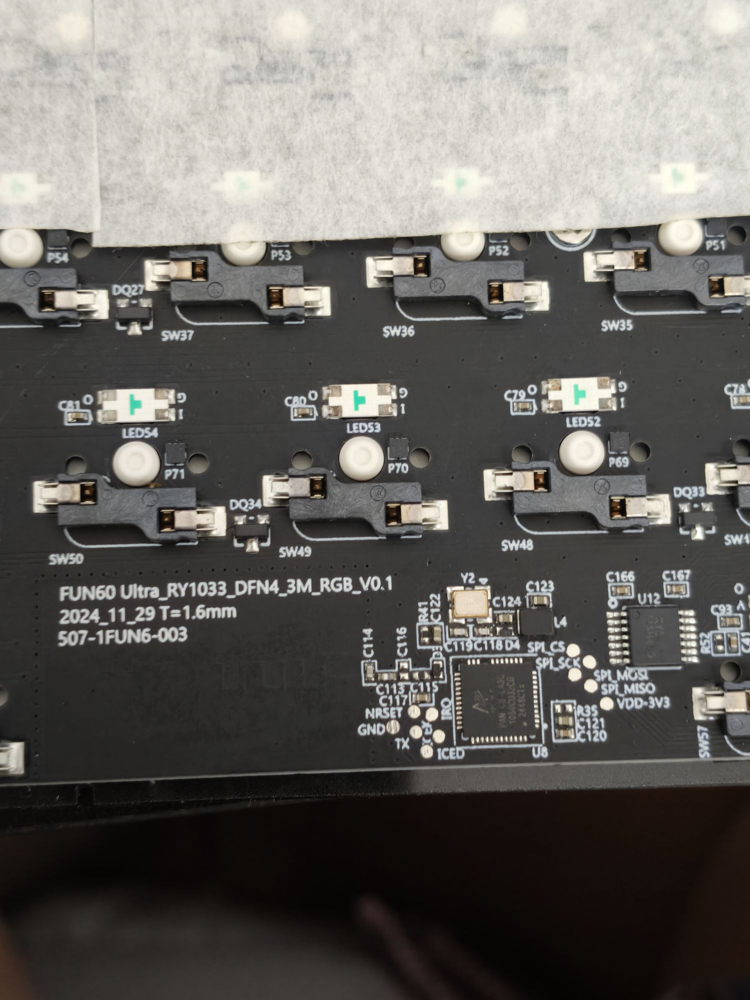

# Recovery with the case open

Try the easy ways first: hold Esc while plugging in, or wait for the failsafe (a build that hangs
or never reaches the PC drops itself into the bootloader). This page is for when neither works,
for example after a firmware that breaks USB, like the one that started all this.

The AT32F405 has a ROM bootloader that nothing can overwrite. It runs instead of the flash when
the BOOT0 pin is high at power-up, and it speaks USB DFU. You can write the full stock image back
with it, factory bootloader included.

## What you need

- a way to get the PCB out of the case (the pads are on the bottom side, with the switch sockets)
- a short wire or tweezers
- `dfu-util` (`nix-shell -p dfu-util`)
- the stock image. ry-flash downloads it from MonsGeek's server:
  `flasher/target/release/ry-flash --fetch 2307 --stock-dir stock` gives
  `stock/2307/fw_at32.bin` (110268 bytes, bootloader plus v306)

## Steps

1. Unplug the cable and disconnect the battery connector.
2. Find the round pad silkscreened **BOOT1** just below the MCU (the chip marked RY5088). Despite
   the label, it's the chip's BOOT0 pin (pin 60).

   

3. Find the **VDD-3V3** pad next to the radio chip (PAN1080, U8), at the end of the SPI pads.

   

4. Bridge BOOT1 to VDD-3V3 and, while holding it, plug the cable in. Let go after a second.
5. Check that the ROM bootloader is there:
   ```
   lsusb | grep 2e3c:df11        # "Artery-Tech DFU in FS Mode"
   ```
6. Write the stock image:
   ```
   nix-shell -p dfu-util --run 'sudo "$(command -v dfu-util)" -a 0 -d 2e3c:df11 -s 0x08000000:leave -D stock/2307/fw_at32.bin'
   ```
   `:leave` restarts the chip when it's done, and the keyboard comes back on stock v306.
7. From there, ry-flash works over USB again, with no need to open the case. Put the battery back.

If `2e3c:df11` doesn't show up, the bridge wasn't making contact when the cable went in. Unplug
and try again.
